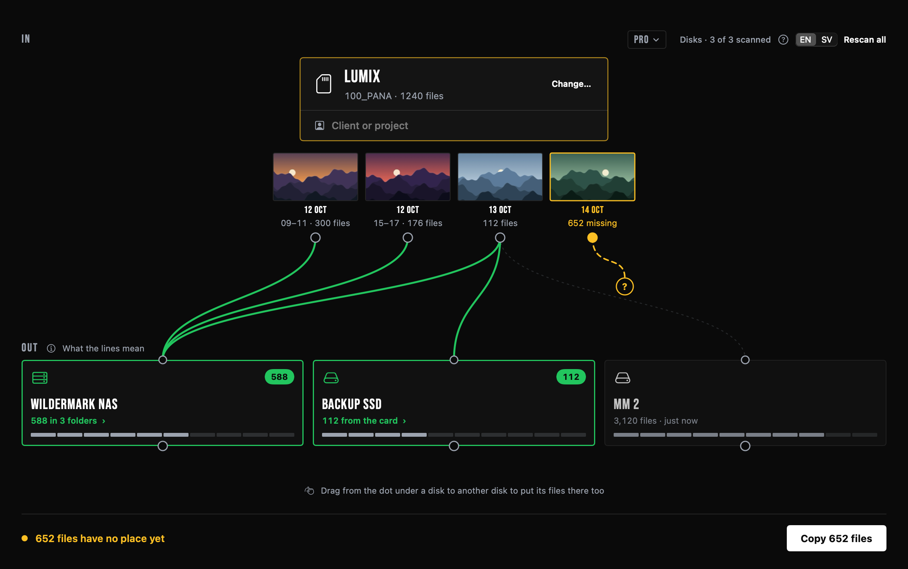
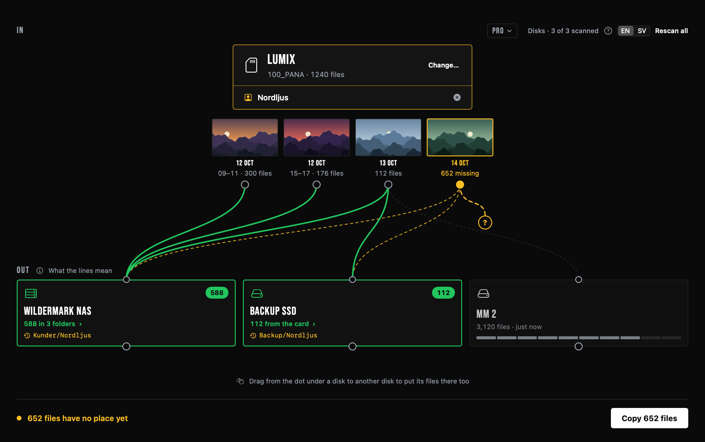
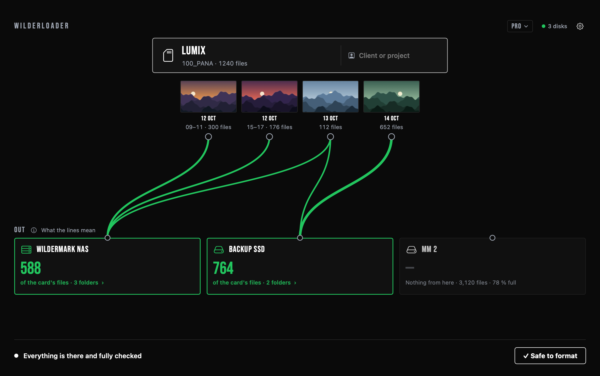
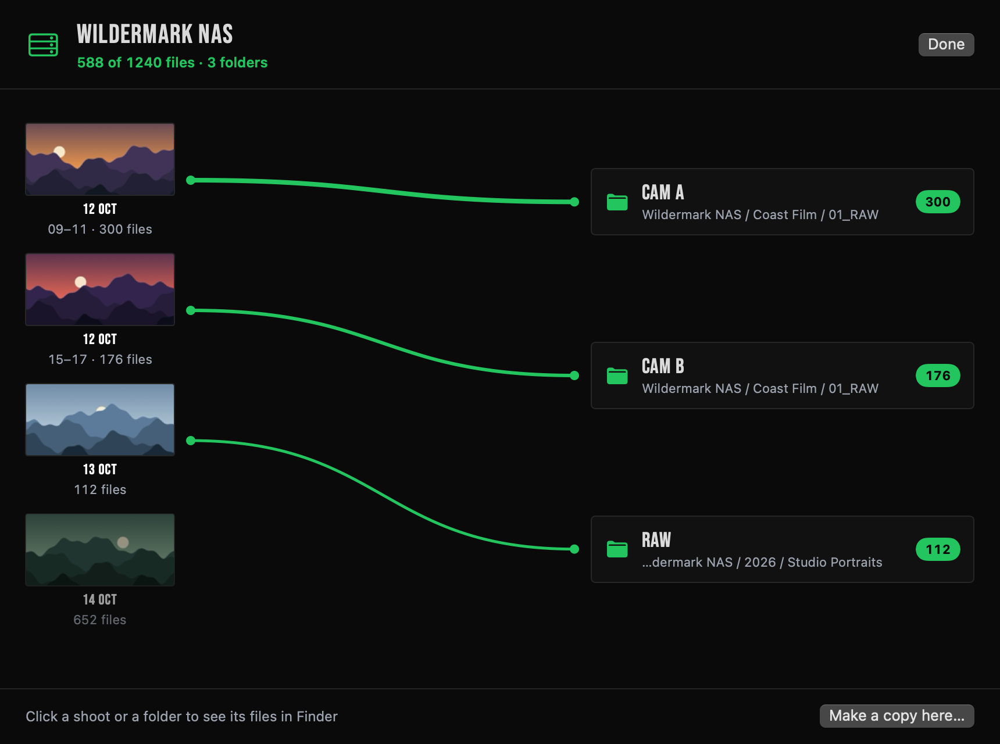
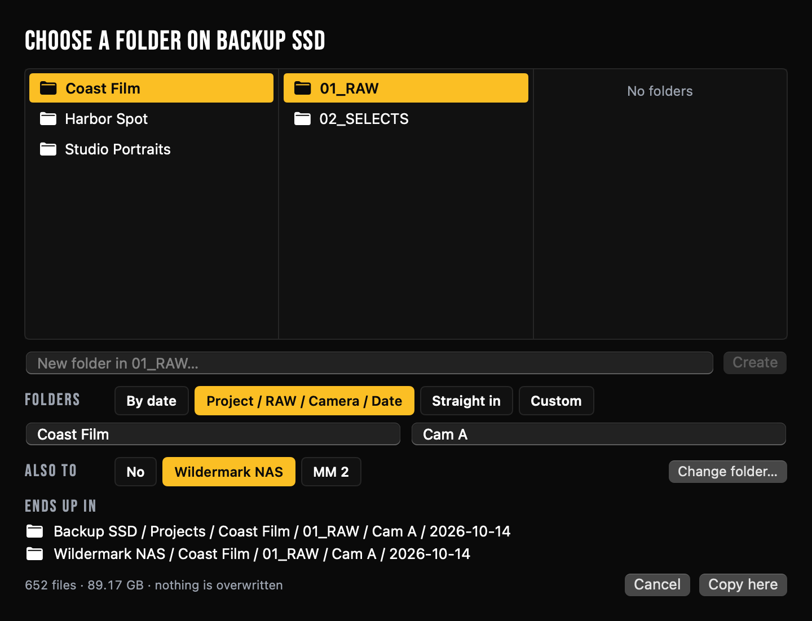
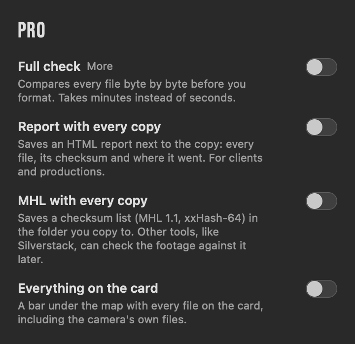

# WilderLoader

A small Mac app for offloading memory cards. It shows which files on a card, disk or folder are already on your other drives or NAS, and where.

- See every shoot on the card, with a line to each drive that already has it. Anything that isn't backed up shows up in yellow.
- Drag a shoot to a drive to copy it. Every copy is checked against the original with xxHash-64.
- Type a client or project on the card, and the drives show where that client's footage went before.
- Every file on the card is shown, including the ones that aren't photos or videos, so nothing gets left behind.
- If a copy is interrupted, for example by a loose cable, it picks up where it stopped.
- Insert several cards in a row, and each one can go to the same place as the last.
- Each card keeps a history of what was copied where, and when.
- Copy to two drives at once. If one fills up, the other keeps going.
- Sort copies with folder templates, like `Project/01_RAW/Cam A/2026-11-05`.
- Finds renamed copies by size and samples of their content.
- Plays a sound and sends a notification when the copy is done.
- Tells you when there's a new version, shows what's new and updates itself.
- Click the dot on a drive to see which folders each date ended up in.
- Format and eject the card from the app when everything is there.
- No account and no cloud. Everything stays on your Mac.

## Formats

WilderLoader looks for cinema RAW and video (BRAW, R3D, ARRIRAW, Canon Cinema RAW, CinemaDNG, MXF, ProRes and more), photo RAW from the major brands, action and 360 cameras, and audio recorders (WAV, BWF, RF64, W64, AIFF, MP3, FLAC and more). Sidecar files like XML, RMD and SRT are copied along with their clip.

No list can cover everything. If a card holds a file WilderLoader doesn't recognize, it tells you and blocks the green format button, so you decide what to do with it.

## Pro

Behind the PRO button: a full byte-by-byte check of files already on a drive, an HTML report with every copy, MHL 1.1 checksum files for other tools, and a bar showing everything on the card.

The screenshots use demo data.

## Safety

WilderLoader never overwrites a file. It only erases when you format a card, and it asks first. Unless every file has had a full check against its copy, you have to type the card's name to format. Files found only in the list for a disconnected drive are matched by name and size, so they count as unchecked until you connect the drive. Files it doesn't recognize also make you type the name. It's a beta, so please don't trust it as your only backup yet.

## Download

Get the latest zip under [Releases](../../releases). It's free while it's in beta. It runs on Apple silicon and Intel Macs with macOS 14 or later. From 0.3 on, the app tells you about new versions itself.

The app isn't notarized yet, so macOS will warn you the first time you open it.

## Source code

From 0.4 on, the source code is private and all rights are reserved. Versions 0.1 to 0.3 beta were published under the MIT License, and those copies stay under MIT.
