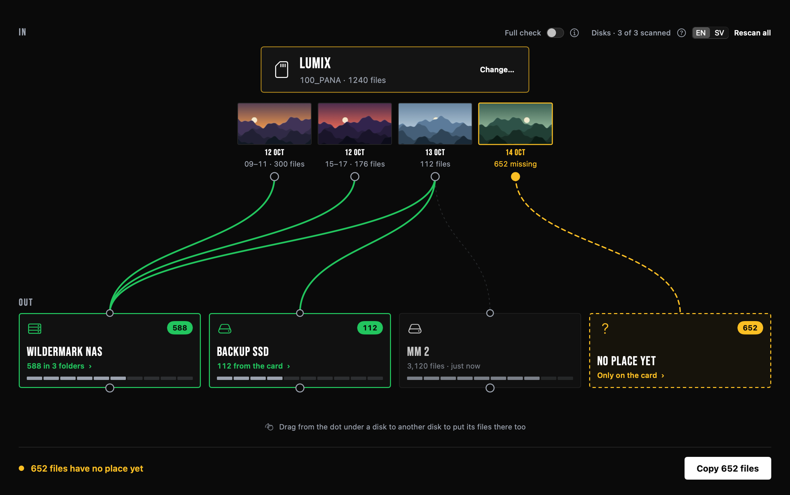
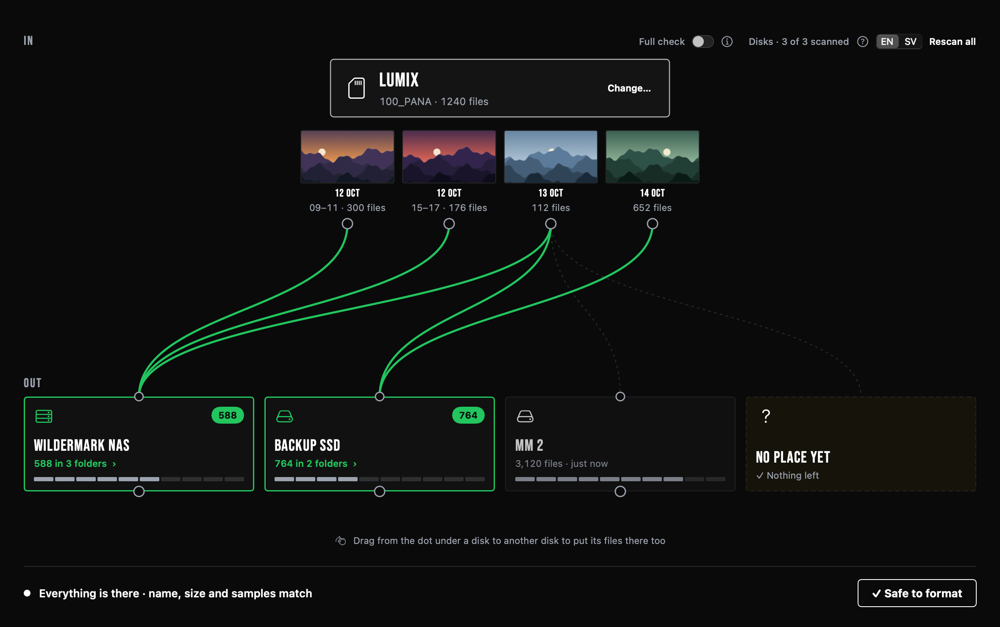
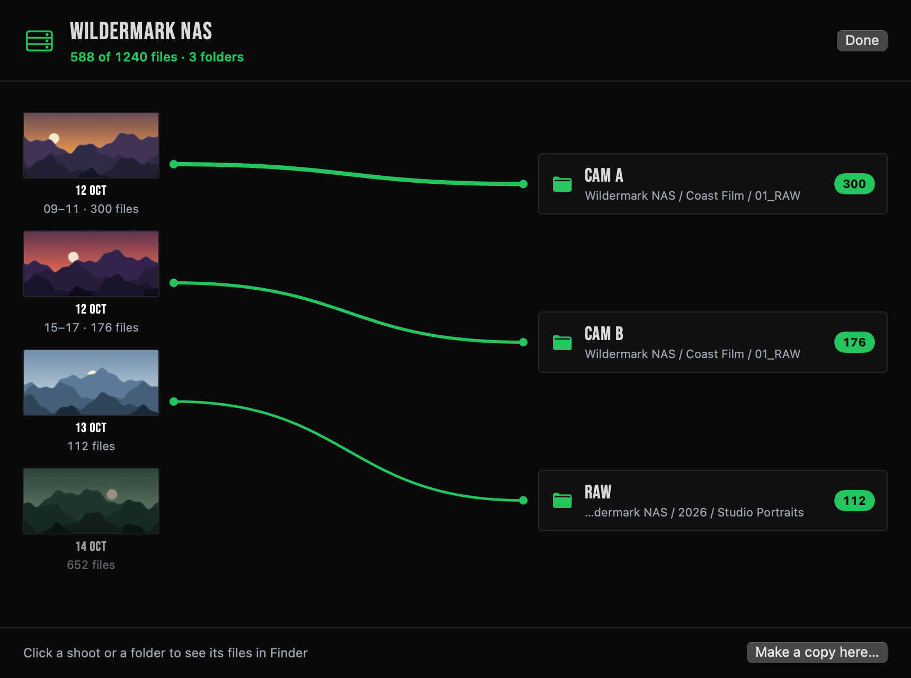

# WilderLoader

A small Mac app for offloading memory cards. It shows which files on a card, disk or folder are already on your other drives or NAS, and where.



- See every shoot on the card, with a line to each drive that already has it. Anything that isn't backed up shows up in yellow.
- Drag a shoot to a drive to copy it. Every copy is checked against the original with SHA-256.
- Click the dot on a drive to see which folders each date ended up in.
- Format and eject the card from the app when everything is there.
- No account and no cloud. Everything stays on your Mac.





The screenshots use demo data.

## Safety

WilderLoader never overwrites a file. It only erases when you format a card, and it asks first. It's a beta, so please don't trust it as your only backup yet.

## Download

Get the latest zip under [Releases](../../releases). It needs Apple silicon and macOS 14 or later.

The app isn't notarized yet, so macOS will warn you the first time you open it. If you'd rather not trust a prebuilt app, build it yourself.

## Build

You need the Swift toolchain from Xcode or the Command Line Tools.

```bash
./build.sh
```

The app ends up in `build/WilderLoader.app`.

To run the self-test, which creates and erases temporary disk images:

```bash
swift build && .build/debug/Kortkoll --selftest
```

The Swift target is still called `Kortkoll`, the app's first name.

## License

[MIT](LICENSE). The Bebas Neue font is licensed separately under the [SIL Open Font License](Resources/Fonts/OFL.txt).
